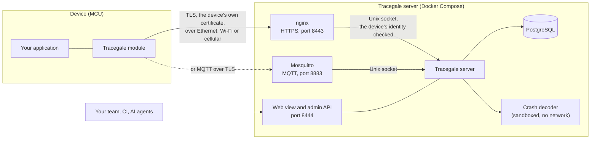
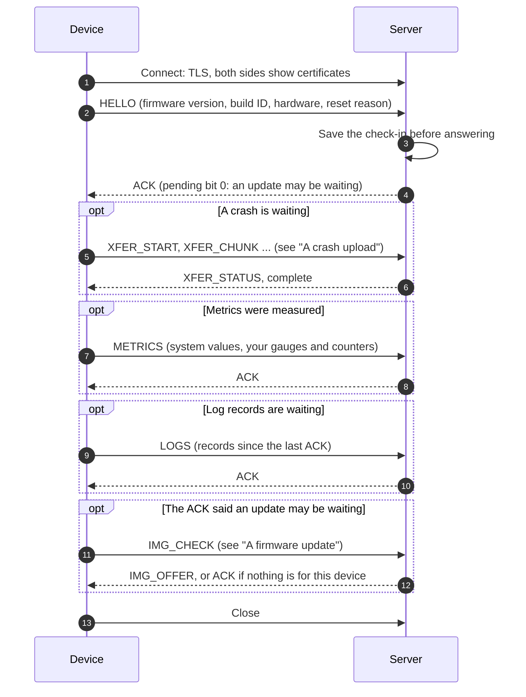
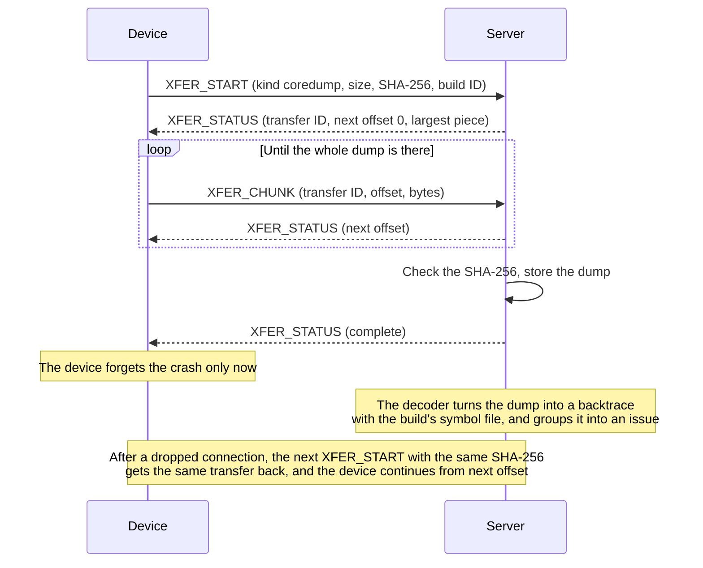
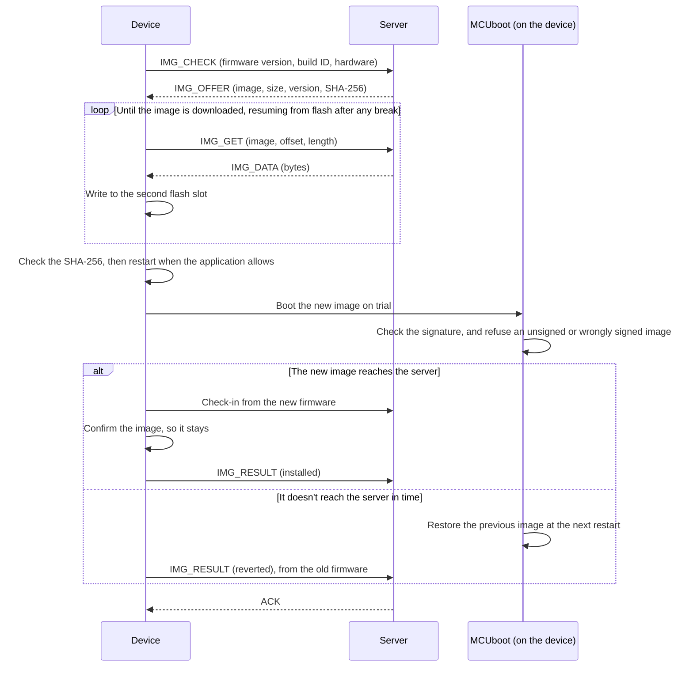

# Tracegale device protocol

How a device and the server talk, message by message: for anyone writing their own device code or checking what goes over
the wire. You don't need it to use Tracegale.

This is version 1. New fields and message types can be added as "Versions and new features" describes; any other change
would make a version 2.

Decode any message offline with `tools/wire/tracegale_wire.py <hex>`. Shared test vectors are in `vectors.json`. Every
implementation must accept the valid ones and reject the invalid ones.

## Layers

| Layer | Job |
|---|---|
| Messages (this file) | What a device and the server say. Identical on every link |
| Binding | How messages travel over one link, including its security |
| Link | Whatever connection the application already has |

Crash, OTA, metric and log code uses only the message layer.

## Identity

A device is identified only by the credentials that secured its connection. No message carries a device identity that
the server trusts, so a compromised device can't claim to be another one (threats T4 and T8).

A device's identity is `dev-` and 32 hexadecimal digits. An **enrollment key's** is `enroll-` and 32: its claim certificate,
built into firmware, lets a device without credentials of its own connect, and send only `ENROLL`. See
[Enrollment](#enrollment).

## How it fits together

These diagrams show what happens; the sections below define each message exactly.

### The parts

A device never names itself in a message: nginx or the broker takes its identity from the certificate it connected with.

### A check-in

A device checks in every hour by default, and soon after its network comes back. Everything happens on one connection,
which it then closes.

If the server is too busy, any reply can be `ERROR` with `server_busy` and a time to wait; the device keeps what it hasn't
sent and tries again later.

### A crash upload

The device keeps the crash through the reset, and sends it at its next check-in. A dropped connection costs at most one
repeated piece.

### A firmware update

The server only offers; the device decides, and its bootloader, MCUboot, refuses any image without a valid signature.

## Message format

A message is one CBOR array of four items (RFC 8949): `[version, type, id, body]`.

| Item | Rule |
|---|---|
| `version` | Unsigned integer, currently `1` |
| `type` | Unsigned integer from the table below |
| `id` | Unsigned 32-bit integer chosen by the sender of a request. A reply repeats it |
| `body` | Map with unsigned integer keys |

`id` is the one value that traces a message from firmware logs to server storage. It's for matching and debugging, and
it carries no security meaning.

### Strict encoding

A receiver rejects a message with error `malformed` if any of these is true, so that two decoders can't disagree about
what a message means:

- It's longer than 65,535 bytes, or a binding's lower limit.
- An integer or length isn't in its shortest form.
- It uses an indefinite length, a tag, a float or another simple value besides `false`, `true` and `null`.
- Map keys aren't unsigned integers in strictly ascending order.
- Text isn't valid UTF-8.
- Nesting is deeper than 4 levels, or an array or map has more than 256 items.
- Bytes follow the end of the message.

### Versions and new features

- **Unknown field:** ignored, so new optional fields don't need a new version.
- **Unknown type:** answered with `unsupported_type`, and the connection continues.
- **Different `version`:** answered with `unsupported_version`. Version numbers change only for a change old receivers
  would misread.
- **New message types:** a server can use one only with a device that has shown it supports it through `HELLO`.

## Message types

D is device and S is server.

| Type | Name | Direction | Fields | Reply |
|---|---|---|---|---|
| 1 | `HELLO` | D to S | 0 `fw_version` text, 1 `build_id` bytes, 2 `hardware` text, 3 `reset_reason` uint, 4 `max_chunk` uint | `ACK` |
| 2 | `ACK` | S to D | 0 `pending` uint, optional | None |
| 3 | `ERROR` | Either | 0 `code` uint, 1 `retry_after_s` uint, optional, 2 `detail` text up to 64 bytes, optional | None |
| 4 | `METRICS` | D to S | 0 `period_s` uint, 1 `system` map, optional, 2 `gauges` array, optional, 3 `counters` array, optional | `ACK` |
| 5 | `LOGS` | D to S | 0 `boot` uint, 1 `uptime_ms` uint, optional, 2 `records` array, 3 `dropped` uint, optional | `ACK` |
| 10 | `XFER_START` | D to S | 0 `kind` uint, 1 `total_len` uint, 2 `sha256` 32 bytes, 3 `build_id` bytes, optional, 4 `flags` uint, optional | `XFER_STATUS` |
| 11 | `XFER_CHUNK` | D to S | 0 `xfer_id` uint, 1 `offset` uint, 2 `data` bytes | `XFER_STATUS` |
| 12 | `XFER_STATUS` | S to D | 0 `xfer_id` uint, 1 `next_offset` uint, 2 `chunk_max` uint, 3 `complete` bool | None |
| 20 | `IMG_CHECK` | D to S | 0 `fw_version` text, 1 `build_id` bytes, 2 `hardware` text | `IMG_OFFER` or `ACK` |
| 21 | `IMG_OFFER` | S to D | 0 `image_ref` uint, 1 `total_len` uint, 2 `kind` uint, 3 `base_sha256` 32 bytes, delta only, 4 `fw_version` text, 5 `sha256` 32 bytes | None |
| 22 | `IMG_GET` | D to S | 0 `image_ref` uint, 1 `offset` uint, 2 `len` uint | `IMG_DATA` |
| 23 | `IMG_DATA` | S to D | 0 `image_ref` uint, 1 `offset` uint, 2 `data` bytes | None |
| 24 | `IMG_RESULT` | D to S | 0 `image_ref` uint, 1 `outcome` uint | `ACK` |
| 30 | `ENROLL` | D to S | 0 `serial` text, 1 to 64 printable ASCII without spaces, 1 `hardware` text, 2 `public_key` bytes: P-256, uncompressed, 65 | `ENROLLED`, or `ERROR` `pending_approval` |
| 31 | `ENROLLED` | S to D | 0 `device_id` text, 1 `cert` bytes: the device's certificate, DER | None |

`ACK` bit 0 of `pending` means an update may be available, so a device can learn this from any reply, with no open
connection or extra polling. `XFER_START` `kind` is 1 for a coredump, the only kind in use; 2 is reserved, and logs travel in `LOGS` messages
instead. The values of `outcome` are under "Server to device: firmware images", and the fields of
`METRICS` under "Metrics".

`build_id` is the GNU build ID of the firmware image, up to 64 bytes, which the server uses to find the matching symbol file.
In `HELLO` it's the running image's, and it's empty only if the firmware was built without one. A device
also sends it in `XFER_START` for a coredump, because a crash can be sent after an update, and must be decoded with the
image that crashed.

A coredump (`kind` 1) is Zephyr's own coredump format, as written to a coredump backend: `include/zephyr/debug/coredump.h`.
For a coredump, `flags` bit 0 means the dump didn't fit the device's store, so some memory was left out. Other bits are
reserved and must be 0.

`reset_reason` is one of these, using the most specific cause when hardware reports several:

| Value | Reason |
|---|---|
| 0 | Unknown, or the board can't tell |
| 1 | Power on |
| 2 | Reset pin |
| 3 | Software |
| 4 | Watchdog |
| 5 | Brownout |
| 6 | Debugger |
| 7 | CPU lockup |
| 8 | Wake from low power |

## Moving large data

One scheme works on every link, because the sender needs nothing from the link except delivery of whole messages. HTTP
ranges aren't used for this, which keeps OTA and crash code independent of the link.

### Device to server: crash dumps

1. The device sends `XFER_START`. The server replies with `XFER_STATUS`.
2. The device sends `XFER_CHUNK` from `next_offset`, each no larger than `chunk_max`, and each reply gives the new
   `next_offset`.
3. When `next_offset` reaches `total_len` and the SHA-256 matches, the server replies with `complete` set to true.

**Resuming:** the server finds a transfer by the device and its `sha256`, so sending `XFER_START` again after a dropped
connection or a reboot returns the existing `xfer_id` and progress. The device keeps no transfer state of its own.
Because of this, **each upload's data must differ**: identical data is taken as the same upload, already complete, so a
second crash identical to the first would never be counted. Tracegale's firmware adds a crash counter to every coredump.

**Repeats and gaps:** a chunk the server already has, or one beyond `next_offset`, changes nothing. The reply still gives
the correct `next_offset`, and the device continues from there. A lost reply therefore costs one repeated chunk.

**A bad hash:** the server replies `hash_mismatch` and discards the transfer.

### Server to device: firmware images

1. The device sends `IMG_CHECK`, and the server replies with `IMG_OFFER` if the device should update.
2. The device asks for bytes with `IMG_GET`, as often and in whatever sizes suit it, and writes each `IMG_DATA` to flash.
3. After MCUboot has tried the image, the device sends `IMG_RESULT`.

**Resuming:** the device finds its position from what it has written to flash, and asks from there. The server keeps no
state for each download, which matters at 100,000 devices.

A server may return fewer bytes than `len`. Over TCP, larger chunks use much less data and time, at a cost in RAM. A device
sets its own limit with `max_chunk`, and uses the smaller of that and the server's `chunk_max`. 1,024 bytes was
measured to suit a device with 64 KB of RAM.

**Trust:** `sha256` only detects a damaged or wrong download. Only MCUboot's signature check, on the device, decides
whether an image runs, so a breached server can't get its own image booted (threat T1).

**When a device asks:** only after a reply in the same connection had bit 0 of `pending` set. A device that's told nothing
sends no `IMG_CHECK`, so a fleet with no rollout costs the server nothing.

**The image:** `kind` 0 is one MCUboot image, signed, exactly as it's written to the second slot. `sha256` and `total_len`
describe those bytes. The first `IMG_DATA` must carry at least the image's 32-byte header, which a device examines before
it writes anything.

**`IMG_RESULT`** ends an update on a device, and a device may send it without downloading anything, to decline an offer.
`outcome` is one of:

| Value | Name | Meaning | Can another try end differently? |
|---|---|---|---|
| 1 | `installed` | The image runs and is confirmed. Also sent, without a download, by a device that already runs it | Not needed |
| 2 | `not_started` | The bootloader didn't start it, for example because its signature is wrong | Rarely |
| 3 | `reverted` | It started and wasn't confirmed, so the bootloader brought the previous image back | Yes |
| 4 | `damaged` | What was downloaded doesn't have the offered `sha256` | Yes |
| 5 | `too_large` | It doesn't fit the device's second slot | No |
| 6 | `not_an_image` | It doesn't start with an MCUboot image header | No |
| 7 | `downgrade` | It's older than the running image, and the device refuses older images | No |
| 8 | `storage` | The device's flash or settings storage failed | Yes |
| 9 | `unsupported_kind` | The device can't use this `kind` | No |

A server treats a value it doesn't know as a failure that another try won't change. A server must not offer an image
again without limit to a device that keeps failing it. A device has its own limits as well, and doesn't rely on the
server's: it can decline an image that already failed on it, and wait before it takes another update after a failure.

**A rollout that changes during a download:** the server answers `IMG_GET` with `unknown_image`, and the device sends
`IMG_CHECK` again. If the new offer has the same `sha256` and `total_len`, the device continues its download under the
new `image_ref`.

### Room for delta updates

`IMG_OFFER` `kind` is `0` for a full image. `1` is reserved for a delta, with `base_sha256` naming the image it applies
to. v1 devices never send anything saying they can use deltas, so a v1 server only offers `kind` 0, and a device receiving
a kind it doesn't know sends `IMG_RESULT` with outcome `unsupported_kind`. `IMG_GET` and `IMG_DATA` work unchanged for a delta.

## Metrics

A `METRICS` message is one report: what a device measured over the `period_s` seconds that end when it's sent. The server
records when a report arrived, so a device needs no clock.

There are two kinds of metric, and every value is an integer from -2^63 to 2^63 - 1:

- A **gauge** is a reading at one moment, such as free memory. A report carries the latest reading.
- A **counter** adds up, such as bytes sent. A report carries the total for the period, and the device starts again from
  zero once the report is acknowledged.

**`system`** holds what Tracegale's firmware measures by itself, as a map from these keys to values. A device sends the
ones its build can measure. A server keeps a key it doesn't know under its number, or ignores it.

| Key | Name | Kind | Meaning |
|---|---|---|---|
| 1 | `uptime_s` | Gauge | Seconds since the device started |
| 2 | `heap_free` | Gauge | Bytes free in the system heap |
| 3 | `heap_low` | Gauge | The fewest bytes the system heap has had free since the device started |
| 4 | `stack_low` | Gauge | The fewest bytes any thread's stack has had free since the device started |
| 5 | `cpu_load` | Gauge | Thousandths of the period's CPU time that weren't spent idle |
| 6 | `net_sent` | Counter | Bytes sent on all network interfaces |
| 7 | `net_received` | Counter | Bytes received on all network interfaces |
| 8 | `checkin_failures` | Counter | Attempts to reach the server that failed |
| 9 | `checkin_ms` | Gauge | Milliseconds the latest check-in took, from opening the connection to the reply to `HELLO` |

**`gauges` and `counters`** hold the application's own metrics. Each is an array of pairs, a name and then its value, such
as `["battery_mv", 3712, "temperature_c", -4]`. A name is 1 to 32 bytes of ASCII letters, digits and `_`. The limit of 256
items in an array makes that 128 metrics in each.

- **Nothing to report:** a device leaves out a gauge that wasn't set during the period, and may leave out a counter that
  didn't change. A report without a counter means the counter didn't change.
- **More than fits one message:** a device sends several `METRICS` messages with the same `period_s`, and each metric is in
  only one of them.
- **No reply:** the device keeps its values, and reports them later with a longer `period_s`. If it was the reply that got
  lost, the server has that period twice, so counters are estimates and not accounts.
- **Errors:** after `rate_limited` or `server_busy` the device keeps its values and tries again later. After any other
  error it discards the report, so a report the server will never take isn't sent for ever.
- **Limits:** a server may limit how many different names it keeps, and how often a device reports (threat T11). It drops
  the values of names beyond its limit without an error, so that the rest of the report is kept. A name that breaks the
  rule above, or an odd number of items, is `malformed`.

## Logs

A `LOGS` message carries records that a device logged, in the order it logged them. A device has no clock, so it gives
times as its uptime, and the server places each record in time by its own clock.

- **`boot`** is a random number the device picks each time it starts. All records of one start share it.
- **`uptime_ms`** is the device's uptime when it sends the message. It's left out when the records come from an earlier start.
- **`records`** is an array of records, each itself an array of five items:

| Item | Name | Type | Meaning |
|---|---|---|---|
| 0 | `seq` | uint | 0 for the first record kept after a start, and one more for each record after it |
| 1 | `uptime_ms` | uint | The device's uptime when it logged the record |
| 2 | `level` | uint | 1 error, 2 warning, 3 info, 4 debug |
| 3 | `module` | text | The name of the part of the firmware that logged it, 0 to 32 bytes |
| 4 | `text` | text | The message, 0 to 255 bytes |

- **`dropped`** counts records the device lost since its last `LOGS` message, because its buffer was full.

Rules:

- **Order:** a device sends records in the order of their `seq`.
- **No duplicates:** the server remembers the highest `seq` it has stored for each device and `boot`, and ignores records at
  or below it. So a device that gets no reply sends the same records again, and the server stores them once.
- **Time:** the server stores a record at the time the message arrived, less the message's `uptime_ms` minus the record's.
  A record from an earlier start can't be placed that way, and a device sends those with that start's `boot` and no
  `uptime_ms`; the server then stores the arrival time and marks the time as unknown.
- **Text:** a device replaces bytes that aren't valid UTF-8, and cuts a message that's too long.
- **Errors:** as for `METRICS`. After `rate_limited` or `server_busy` the device keeps its records and tries again later.
  After any other error it drops the records it sent. A record outside these rules, or a level outside 1 to 4, is `malformed`.
- **Limits:** a server may limit how many records it keeps for each device, and drops the rest without an error.

## Error codes

| Code | Name | Meaning | What the sender should do |
|---|---|---|---|
| 1 | `malformed` | Breaks a rule in this file | Report a bug. Don't repeat the message |
| 2 | `unsupported_version` | Different `version` | Wait for a firmware or server upgrade |
| 3 | `unsupported_type` | Unknown `type` | Stop using that feature for this connection |
| 4 | `missing_field` | A required field is absent | Report a bug |
| 5 | `too_large` | Larger than `chunk_max` or another limit | Use a smaller size |
| 6 | `bad_offset` | `IMG_GET` is outside the image | Restart the download from `IMG_CHECK` |
| 7 | `hash_mismatch` | The SHA-256 doesn't match the data | Restart the transfer |
| 8 | `unknown_transfer` | No such `xfer_id` for this device | Send `XFER_START` again |
| 9 | `unknown_image` | No such `image_ref`, for example after a rollout was aborted | Send `IMG_CHECK` again |
| 10 | `rate_limited` | Over a limit (threat T11) | Wait `retry_after_s` |
| 11 | `not_authorized` | This device may not do this | Don't retry until the next boot |
| 12 | `server_busy` | Temporary overload | Wait `retry_after_s`, or back off with jitter |
| 13 | `unsupported_kind` | Unknown `kind` | Ignore that offer or transfer |
| 14 | `pending_approval` | An enrolling device, or its new key, waits for a person to approve it | Send `ENROLL` again after `retry_after_s`, with the same key |

## Cost per message

Measured with the decoder's encoder:

| Message | Bytes around the data |
|---|---|
| `XFER_CHUNK` at offset 8192 | 17 |
| `XFER_CHUNK`, largest possible IDs and offset | 25 |
| `IMG_DATA` at offset 32768 | 17 |
| `IMG_GET` at offset 32768 | 17 in total |
| `METRICS` with all nine system metrics | 45 in total |
| `METRICS`, each of the application's metrics | Its name, plus 2 to 6 bytes |

That's about 3% on a 512-byte chunk.

## Enrollment

A device with no credentials of its own gets them from an enrollment key:

1. The firmware's build has the server's host and CA, and the key's **claim certificate**. The device is given the claim's private
   key, the **token**: `tge_` and the raw 32-byte P-256 scalar in unpadded base64url.
2. The device makes its own P-256 key pair once, and keeps it until it has a certificate.
3. It connects as usual, with the claim certificate, over either binding, and sends `ENROLL` with its serial number, its hardware
   name and its public key.
4. The server answers `ENROLLED` with the device's ID and a certificate for that public key, whose common name is the ID. The
   device checks the certificate is for its own key and names that ID, keeps both, and from then on connects as itself.
5. Or the server answers `ERROR` with `pending_approval` and a `retry_after_s`, and the device asks again later, with the same key.

What the server decides:

| The request | The answer |
|---|---|
| A serial it hasn't seen in the key's project | A new device: `ENROLLED`, or `pending_approval` if the key holds new devices |
| A known serial, with the key it was certified for | The same certificate again, so a lost reply is harmless |
| A known serial, with a new key | `pending_approval`, whatever the key says, until a person approves it |
| A revoked device, or a revoked or unknown key | `not_authorized` |

A device's private key never leaves it, and `ENROLLED` holds only a certificate, which is public. That matters over MQTT, where
every device enrolling with one key shares the key's identity and topics.

## Bindings

There are two bindings, HTTPS and MQTT, carrying the same messages. A device uses one of them, chosen in Kconfig, with
the same credentials either way.

Both bindings:

- Use TLS 1.2 or later, always verify the server's certificate, and have no unencrypted mode in production builds.
  Verifying means the chain up to the provisioned CA, its signatures, and the host name, always. Expiry is checked too when
  the device knows the time; a device without a clock can't, before it first connects, and the CA is private to one server.
- Carry each message as binary: every byte value, unchanged. A link with a text-only mode, such as an MQTT stack on a modem's
  AT commands that checks payloads are UTF-8, must have that turned off.
- Authenticate each device with its own credentials during the TLS handshake.
- Turn off TCP batching with `TCP_NODELAY`. It was measured to make each exchange faster.
- Use small TLS buffers where the server allows. A server must accept the Maximum Fragment Length extension or send small
  records, or devices need a 16 KB receive buffer.

### HTTPS

- A device sends each message as the body of `POST /v1/m`, with content type `application/vnd.tracegale+cbor`.
- The response body is the reply message, with status 200. A message error is an `ERROR` message, also with status 200.
- Any other status comes from the HTTP layer, such as a proxy or an overloaded server, and is retried with backoff.
- A device keeps the connection open for its current work, then closes it.

### MQTT

- MQTT 3.1.1, because Zephyr v3.7 has no MQTT 5.
- A device publishes to `tg/v1/<identity>/up` and subscribes to `tg/v1/<identity>/down`, both at QoS 1.
- `<identity>` is the identity the broker authenticated. The broker's access rules must refuse any other device's topics,
  because the server trusts the identity in a topic only because of those rules.
- A device's identity is its certificate's subject common name, and it connects with that as its client ID, with a clean
  session. The broker must take the identity from the certificate, not from what the client says.
- The reply to a message published on `up` is the next `PUBLISH` on `down`, with the same message ID inside. A device has one
  message outstanding at a time, as over HTTPS.
