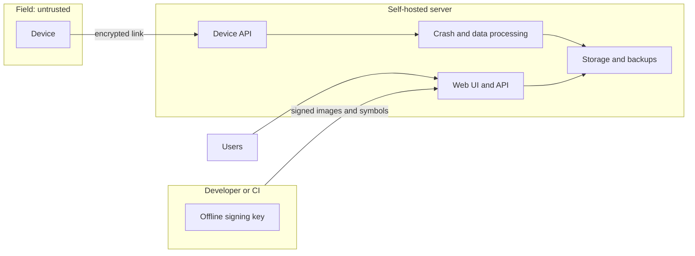

# Threat model

Version 6, 2026-11-10. Each plan reviews this file. Nothing below is implemented yet unless its status says so: the
mitigations are requirements for the plan named.

## What we protect

| Asset | Why it matters |
|---|---|
| Firmware running on devices | A malicious update could take over a whole fleet |
| Firmware signing keys | Whoever holds them can produce firmware that devices accept |
| Device credentials | They let an attacker pretend to be a device or read its data |
| Coredumps, logs and symbols | They can contain secrets, personal data and intellectual property |
| Server accounts and API tokens | They control releases and fleet data |
| Availability of updates | Without it, a security fix can't reach devices |

## Attackers

- Someone on the network between a device and the server
- Someone with physical access to one device
- A compromised or malicious device
- An external attacker reaching the self-hosted server
- A user exceeding their role, or an insider
- A compromised dependency or build tool

## Trust boundaries

Everything coming from a device or the network is untrusted, even when the device has authenticated. A valid device
may still be compromised.

## Threats

| ID | Threat | Requirement | Plan |
|---|---|---|---|
| T1 | A server breach is used to push malicious firmware | Signing keys are never on the server. MCUboot verifies each image before booting it | 09 |
| T2 | An old, vulnerable firmware image is reinstalled | MCUboot downgrade prevention, with hardware counters where available. Documented for each board | 09 |
| T3 | A bad update bricks a fleet | Test swap with automatic revert, health confirmation before committing an image, staged rollout and abort | 09 |
| T4 | A device is impersonated | Unique credentials per device. No shared fleet-wide secret | 02, 05 |
| T5 | Credentials are extracted from one device | One device's credentials give no access to other devices. Revocation. Use secure storage where hardware has it | 05 |
| T6 | Traffic is read or altered in transit | Authenticated encryption with certificate or key validation, on every link. No unencrypted mode in production builds | 02 |
| T7 | Retired on 2026-11-09: a compromised gateway. Bluetooth and its gateway were dropped, so there is no gateway. The number stays unused | None | None |
| T8 | A device sends malformed data to attack the server | Strict limits and parsing. Fuzz all device-facing parsers | 02, 05, 16 |
| T9 | A crafted coredump or ELF attacks the decoder | Process them in a sandboxed, unprivileged process with resource limits and no network access. Tools such as GDB aren't designed for hostile input | 06 |
| T10 | Secrets or personal data appear in coredumps or logs | Stack-focused dump defaults, a way to exclude memory regions, access control, retention limits, and clear documentation | 06, 11 |
| T11 | A device or botnet floods the server | Per-device and per-credential rate and storage limits, with quotas | 05, 15. Measured in plan 15 (`docs/reports/`): 100,000 devices reconnecting within 30 seconds were all served, and 1,000,000 reconnecting at once were all served within 9 minutes, the server telling the rest to retry, with no errors and every service healthy throughout |
| T12 | Device-supplied text attacks users of the web UI | Treat logs and metadata as untrusted. Output encoding and a strict Content Security Policy | 11, 12. Since plan 16, every admin response also tells browsers to isolate the window from other sites and to use HTTPS only (HSTS) |
| T13 | A user exceeds their role, or accesses another organization's data | Authorization checked on the server for every request. Permission tests for each role. Audit log | 12 |
| T14 | Accounts or API tokens are stolen | SSO through OIDC, hashed and scoped tokens, secure session handling, and rotation | 12. Since plan 16, HSTS keeps browsers from ever sending a session over plain HTTP |
| T15 | A backup leaks fleet data | Encrypted backups with documented key handling | 15 |
| T16 | A self-hosted install is misconfigured or left out of date | Secure defaults, no default passwords, generated secrets, clear upgrade path, startup warnings for unsafe settings | 15 |
| T17 | A dependency or build tool is compromised | Pinned versions, checksum checks, SBOM, signed containers | 00, 16 |
| T18 | Repository history is altered or secrets are committed | Linear history check and secret scanning in CI, plus branch protection once available | 00, 08 |
| T19 | Firmware or tools are copied from an incompatible licence | Licence checks in CI, independent implementation | 00 |
| T20 | A crash loop drains a device's battery, flash or data allowance | Rate limit uploads and flash writes on the device, and bound storage use | 04, 06 |

## Status

Reviewed in full on 2026-11-15, in the security review (its reports are in `docs/reports/`): every threat was checked
against the code as it stands, and the ones plans 13 to 16 changed were updated.

| ID | Status |
|---|---|
| T1 | In place, tested on an emulated board with the real MCUboot: the server holds only public halves of signing keys, and never signs. An image signed with another key is downloaded and MCUboot refuses to run it. The server also refuses images signed with MCUboot's published development keys, and checks uploads against the registered keys, but nothing relies on the server's checks. A device can fetch only an image that a rollout offers it. Not yet: run on real hardware |
| T2 | Partly in place: the device refuses an image with a lower version than the one it runs, before writing anything, unless the application allows it. MCUboot's own downgrade prevention and hardware counters are the application's to turn on, and aren't documented for each board yet |
| T3 | Mostly in place, tested on the same emulated board: a new image runs on trial, is kept only after it has reached the server, and goes back by itself after 900 seconds otherwise. Rollouts go to a cohort and a percentage, and can be paused and ended, which stops downloads under way. The server stops offering an image to a device after three failures. Not yet: a rollout doesn't stop by itself when many devices fail, and ending one doesn't bring old firmware back, since devices refuse older versions |
| T17 | Mostly in place (plan 16): CI pins Actions by commit, Zephyr by manifest, the Zephyr SDK by checksums kept in this repository (`ci/zephyr-sdk/`), and gitleaks, Grype, Syft and govulncheck by version and checksum; images are pinned by digest, and the decoder's Debian packages by a dated snapshot. Every server change is scanned for known vulnerabilities in Go code (govulncheck) and in every image (Grype), failing on anything reachable or fixable, and each image and the source get an SBOM. How updates are taken: `docs/security/dependency-updates.md`. Not yet: CI's Python packages, which only build and test, aren't hash-pinned; images aren't signed, because none are published yet, and will be when they are |
| T18 | Partly in place: CI detects merge commits and secrets, after they're pushed. GitHub can't block them on this plan |
| T19 | Partly in place: CI checks that licence information is complete. It can't detect copied code |
| T4, T6 | In place, tested end to end: per-device certificates on both sides, verified by nginx or the MQTT broker and by the device. No unencrypted mode exists. Forged identity headers are ignored. Over MQTT, the broker takes a device's identity from its certificate as its username and client ID, and its access rules keep each device to its own two topics, so the identity in a topic can be trusted: a test publishes to another device's topic with a real device's certificate, and the server never sees it. The broker doesn't read the revocation list, so a revoked device can still connect to it, but the server refuses its messages. The TLS settings were checked in plan 16 against current guidance: TLS 1.2 and 1.3 only, forward-secret AEAD ciphers only, no session tickets |
| T5 | Partly in place: one device's key gives no access to others, and revocation works at the next message. Keys sit in plain flash unless the hardware encrypts it. On the nRF91 series, the TLS key is in the modem's storage, which doesn't give a private key back, and Tracegale keeps no copy of it, only its hash, in memory and in settings storage |
| T11 | Partly in place: messages over MQTT pass the same per-device limits as over HTTPS, because the same code answers them, the server answers at most 512 at once, and the broker keeps at most 16 messages for a device and nothing for one that has gone. Devices back off with jitter, retry after the network returns only within a random wait, each device is rate limited, and overload gets `server_busy`. Storage quotas and a load test are plan 15. Image downloads have their own limit for each device, apart from check-ins, and a fleet with no rollout sends no update messages at all. Reports of metrics have their own limit and queue too, so they can't use up or hold up check-ins. A device's metric names count toward a limit for the whole fleet (`TRACEGALE_METRICS_MAX_NAMES`), beyond which their values are dropped, so a device can't fill the database with names. Reports are kept for 30 days in partitions of one day, dropped whole. Log messages have their own limit and queue as well, and each device may store 10,000 records a day, beyond which they're acknowledged and dropped |
| T8 | A device sends malformed data to attack the server | Strict limits and parsing. Fuzz all device-facing parsers | 02, 05, 16. Plan 16 added fuzzing of the firmware's own parsers of what a server or broker sends, on the host with libFuzzer and address and undefined-behaviour sanitizers: the message reader, the MQTT client and the certificate reader, in every local check and in CI |
| T9 | In place, tested end to end: coredumps are decoded only in the `decoder` container, with no network, a read-only root, memory, process and CPU limits, and a time, output and file-size limit for each dump. Since plan 16 the decoder starts as root with no capability but changing users, and runs each worker's GDB as a user of its own, which can write nowhere and can't signal the decoder, reach its socket or another worker's dump; after every dump, every process of that user is ended, so nothing a dump started outlives it. GDB never runs scripts from an ELF file. The server checks the decoder's answer again, and junk and broken dumps were tested. Not yet: a custom seccomp profile. ELF files come only from administrators |
| T10 | Partly in place: the device dumps only the crashing thread's stack and registers, coredumps and ELF files are shown only to administrators, crashes are deleted after 90 days, and the docs warn about secrets on a stack. Log records are kept 14 days, shown only to administrators, and the firmware and Help guides say not to log secrets; a hex dump sends only its length. A crash that couldn't be sent is also saved in the device's settings storage, unencrypted like the device's private key, which the docs say, and one option turns it off. Not yet: a way to leave out memory regions |
| T20 | Partly in place: a crash is kept in RAM and sent once with the next check-in, and the server limits each device. Flash is written only for a crash that couldn't be sent, once for each such crash, and not again while one is kept, so an offline crash loop writes once. Not yet: a device in a crash loop still checks in at every boot. For updates, the device tries one image three times at most, and waits an hour, doubling to a day, after a failed update before it erases its flash for another, so a server can't wear a device out |
| T12 | Partly in place: device text is escaped by the page templates, and tested, with a strict Content Security Policy. This includes backtraces, whose names and paths come from ELF files and dumps, and metric names, which reach the pages only through the templates' SVG and URL escaping. Log text is kept to printable ASCII on the device, checked as UTF-8 by the server, and escaped on the page, which a test with a script in a record shows. Plan 12 extends it. Since plan 16, every admin response also tells browsers to isolate the window from other sites and to use HTTPS only (HSTS) |
| T14 | Partly in place: each administrator has an account with an Argon2id-hashed password (NIST SP 800-63B rules), server-side sessions that end on logout, password change or disabling, a per-account lockout and a per-address login limit. API tokens are named, per account, shown once, stored as hashes and revocable. First-time setup needs a one-time code from the server. Each account has a role, so a stolen viewer's token reads but can't change anything or download coredumps, and every change, login and failed login is in the audit log with the address it came from. Single sign-on through an OpenID Connect provider uses the code flow with PKCE, a state and a nonce, checks the ID token fully, links accounts by issuer and subject rather than email, and takes the role from the provider's groups at every sign-on, so two-factor authentication and removal are the provider's. Not yet: two-factor codes for password accounts. Since plan 16, HSTS keeps browsers from ever sending a session over plain HTTP |
| T15 | In place, tested by a restore drill on every local check: `backup.sh` encrypts the database and the volumes with age to a public key, as each part is produced, so neither the plain database nor the keys reach a disk, and the server holds no key that decrypts. A backup without a key is refused. A restore goes only onto a new install, refuses one that has keys or data, and decrypts the files in full before writing any; during a restore, that plain copy is only in the short-lived container's work volume, which goes with it. Keeping the secret key off the server, and the backups off the host, is the operator's, and the docs say how |
| T16 | Partly in place: no default passwords, secrets generated at first start, a one-time setup code, and the admin port on this machine only by default. The server warns, in its log and on the overview for server administrators, about device names only this machine has, backups not set up, a trusted proxy range far wider than one proxy, and a nearly full disk. Upgrades take a backup first, and every database version is tested to migrate. Not yet: a warning when the server is out of date |
| T13 | Partly in place: three roles, viewer, operator and administrator, checked on the server for every page, form and API call, in the wrappers every route goes through. A test tries every route as every role, and another fails when a route is added without a decision about who may use it. The last administrator can't be removed. The audit log records every change. Organizations and projects separate fleets: every store query of fleet data takes the project, the device side matches rollouts and issues within a device's project, and a crash is decoded only with a symbol file from its own project, so a device can't name another project's build ID to have that firmware's functions shown. Tests show nothing crosses between projects in the store, the device side, the decoder and the pages. Not yet: a link to something in another project the account can see says "not found" instead of switching to it |
| Others | Not started |
