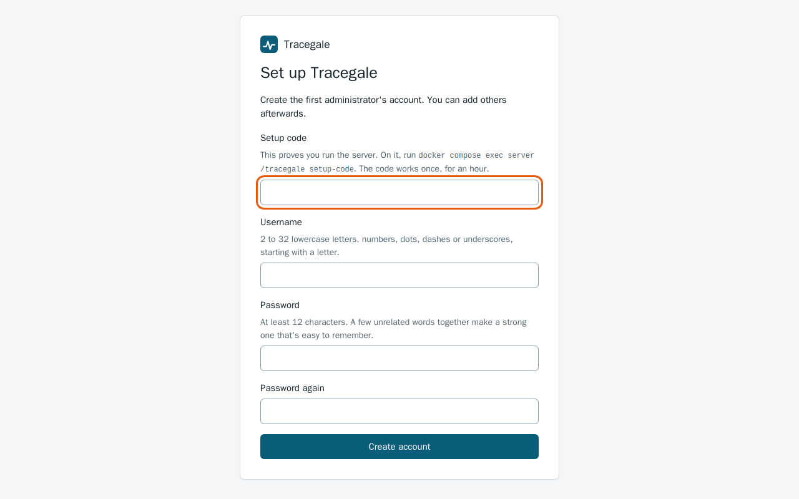
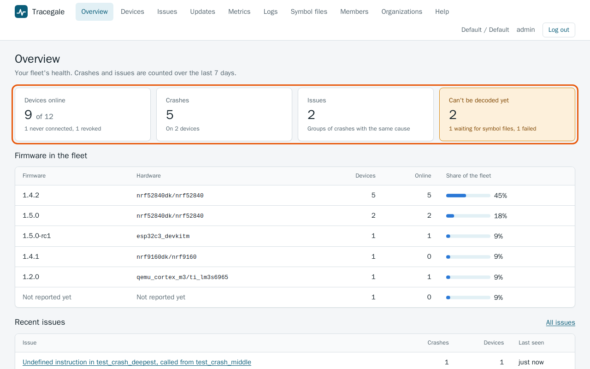

# Getting started

<!-- order: 1 -->
<!-- summary: Create the first account, log in, and find your way around. -->

Tracegale collects crash reports from your Zephyr devices, turns each crash into a backtrace, and groups crashes with the same cause
into issues. It runs on your own server with Docker Compose.

## Create the first account

The first time you open Tracegale, it asks you to set it up. The setup page needs a one-time code, which proves you run the server.

1. On the server, in Tracegale's `server` folder, run this to get a code:

```
docker compose exec server /tracegale setup-code
```

2. Open Tracegale in a browser. You'll see **Set up Tracegale**.
3. Enter the code, then choose a username and a password of at least 12 characters, and choose **Create account**.



> The code works once, for an hour. Run the command again for a new one. Once an account exists, the setup page closes for good.

## Find your way around

After you log in, the **Overview** shows your fleet's health at a glance: how many devices are online, how many crashes came in this
week, how many issues they make, and whether any crashes are waiting to be decoded. Each tile opens the list behind it.



| Section | What it's for |
|---|---|
| **Devices** | Add devices, see which are online, and open one to see its details and crashes |
| **Issues** | Crashes grouped by cause, with backtraces |
| **Symbol files** | Each firmware build's ELF file, which Tracegale needs to decode that build's crashes |
| **Accounts** | Add or disable the people who can log in |
| **Help** | These guides |

Your username, at the top right, opens your account: your password, and API tokens for build machines.

Next: [Add a device](02-add-device.md).
