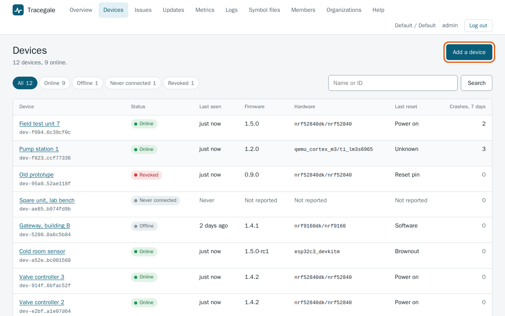
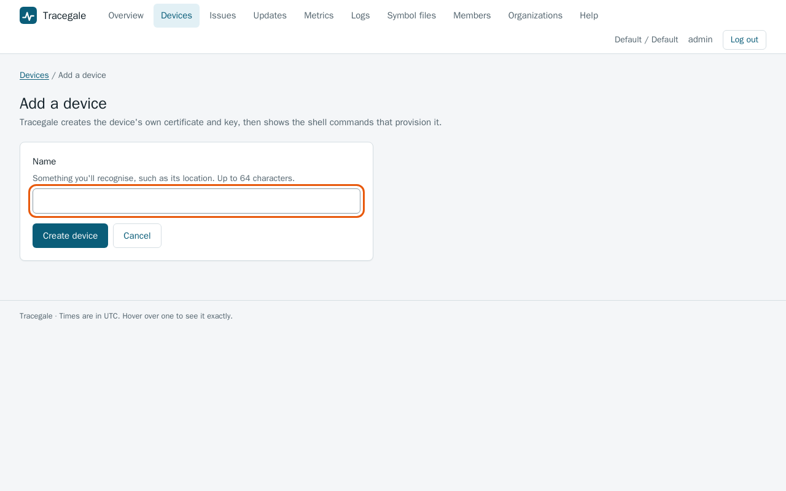
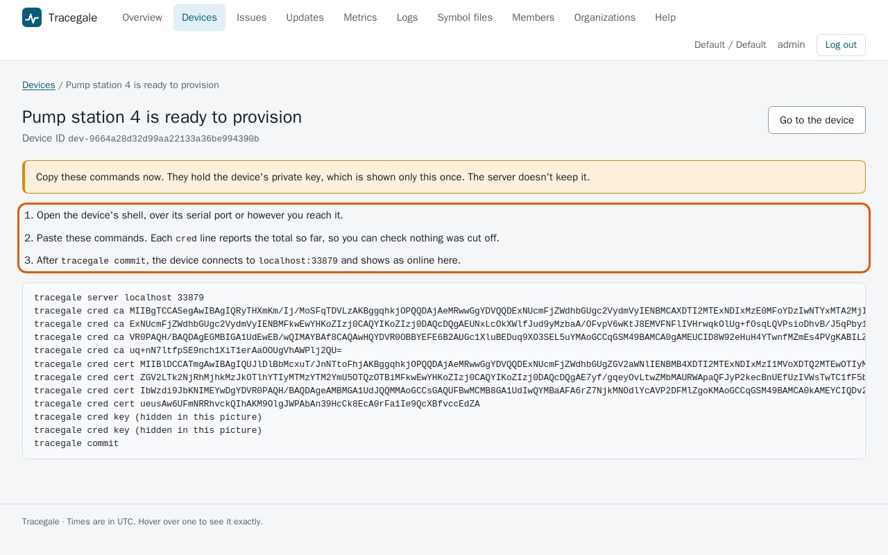

# Add a device

<!-- order: 2 -->
<!-- summary: Give a device its own credentials, and see it come online. -->

Every device has its own certificate and private key, made by Tracegale. Nothing is shared between devices, so if one is lost you
revoke only that one.

## Create the device

1. Open **Devices**, then choose **Add a device**.

2. Give it a name you'll recognise, such as its location, and choose **Create device**.

3. Tracegale shows the shell commands that give the device its server and credentials.

> **Copy the commands now.** They hold the device's private key, and the server doesn't keep it. If you lose them, revoke the
> device and add it again.

## Give the device its credentials

4. Open the device's shell, over its serial port or however you reach it.
5. Paste the commands one at a time. Each `tracegale cred` line reports the total so far, so you can check nothing was cut off.
6. After `tracegale commit`, the device connects. Within a few seconds it shows as **Online**.

Open a device to see its firmware version, hardware, build ID and the crashes it has sent.

Next: [Connect your firmware](03-firmware.md).
