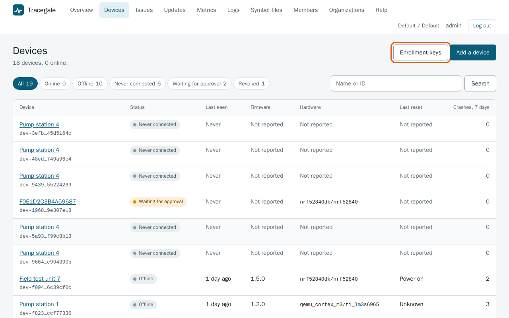
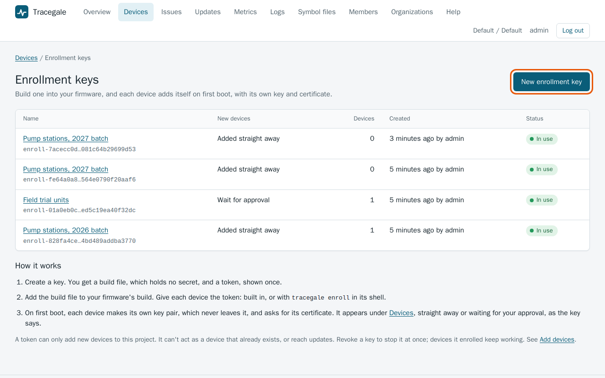
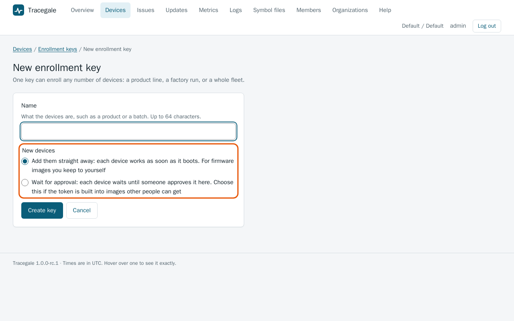
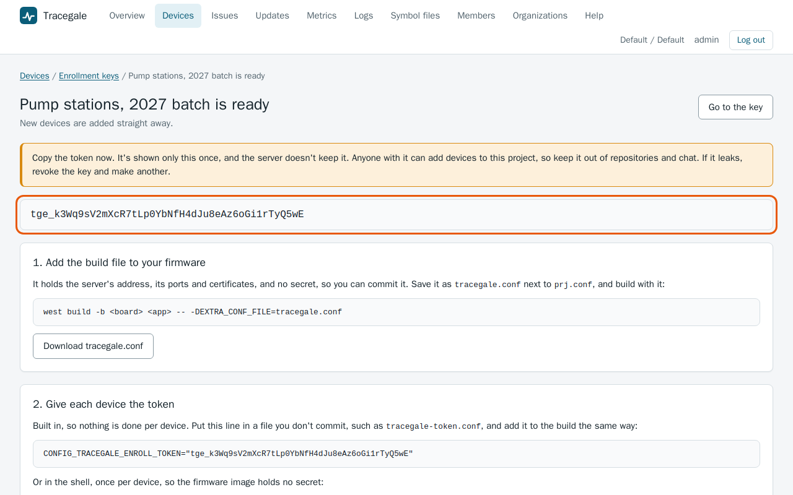
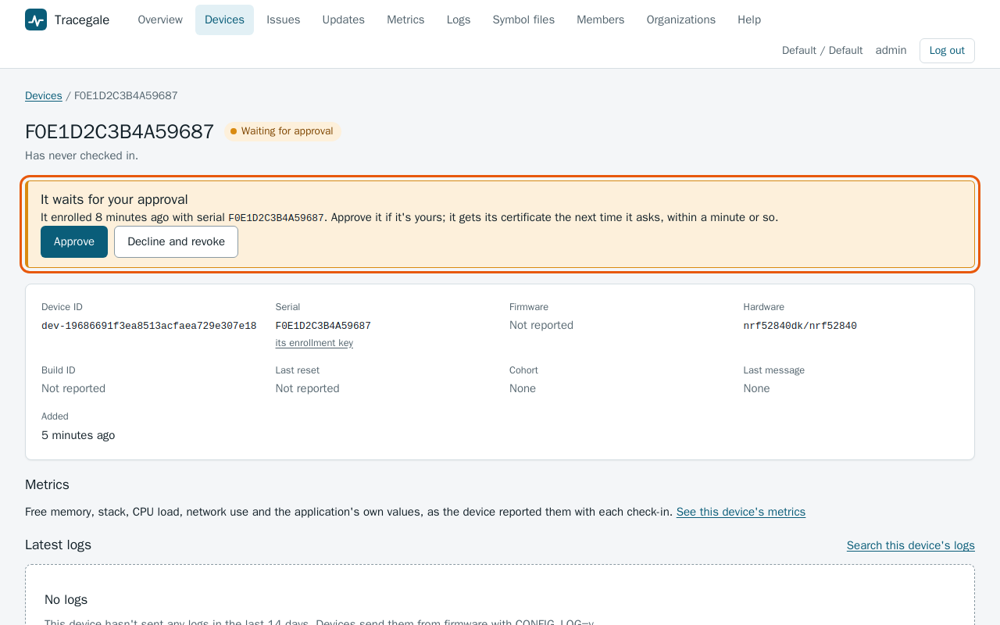
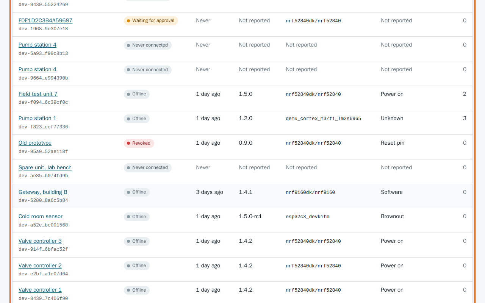
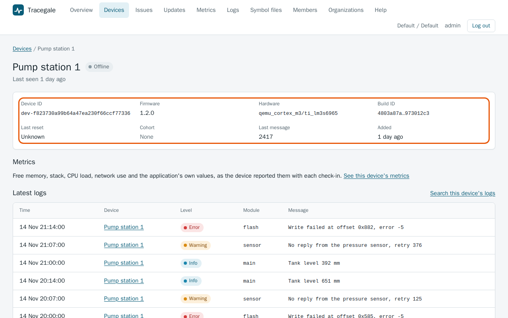

# Add devices

<!-- order: 2 -->
<!-- summary: Let devices add themselves with an enrollment key, or give one device its credentials by hand. -->

Every device has its own certificate and private key. Nothing is shared between devices, so if one is lost you revoke only that one.

There are two ways to give devices their credentials:

| What | Enrollment key | By hand |
|---|---|---|
| For | Any number of devices, and production | One device, or the nRF91 series' modem |
| Per device | Nothing, or one short command | A page of shell commands |
| The device's private key | Made on the device, and never leaves it | Made by the server, and pasted into the device |

## Enroll devices

An enrollment key gives you a **build file** for your firmware, which holds no secret, and a **token**, shown once. A device built
with both makes its own key pair on first boot, asks for its certificate, and appears here by itself.

1. Open **Devices**, then choose **Enrollment keys**.



2. Choose **New enrollment key**.



3. Give it a name, such as a product or a batch, and choose what happens to new devices:
   - **Add them straight away**, for firmware images you keep to yourself.
   - **Wait for approval**, if the token will be built into images other people can get. Each new device then waits until
     someone approves it.



4. Choose **Create key**. Copy the token now, and download the build file, `tracegale.conf`.



> **Keep the token out of repositories and chat.** It can only add new devices to this project, but anyone with it can do that.
> If it leaks, revoke the key on its page and make another. Devices it enrolled keep working.

5. Save `tracegale.conf` next to your application's `prj.conf`, commit it, and build with it. Give the devices the token either
   way:

```
# Built in, so nothing is done per device. Keep tracegale-token.conf out of your repository.
echo 'CONFIG_TRACEGALE_ENROLL_TOKEN="tge_..."' > tracegale-token.conf
west build -b <board> <app> -- -DEXTRA_CONF_FILE="tracegale.conf;tracegale-token.conf"

# Or in each device's shell, once, so the firmware image holds no secret.
west build -b <board> <app> -- -DEXTRA_CONF_FILE=tracegale.conf
uart:~$ tracegale enroll tge_...
enrolling
```

6. Turn the devices on. Each one appears under **Devices**, named after its serial number, which `tracegale status` shows too.

### Approve a device

A device waits for approval when its key says so, or when a device Tracegale already knows asks again with a new key, after an
erase or a reflash. Open **Devices**, then **Waiting for approval**, and open the device.



- **Approve** it if it's yours. It gets its certificate the next time it asks, within a minute or so.
- **Decline and revoke** a new device you don't recognise. It can't ask again.
- For a known device asking with a new key, **Decline the new key** keeps the key it had. Approve only if you know why it lost
  its key: whoever holds the token could ask the same.

## Add one device by hand

1. Open **Devices**, then choose **Add a device**.


2. Give it a name you'll recognise, such as its location. Under **How it connects**, choose the binding its firmware was built
   with: **HTTPS**, the default, or **MQTT** if it has `CONFIG_TRACEGALE_TRANSPORT_MQTT=y`. That sets the port in the commands.
   Then choose **Create device**.


3. Tracegale shows the shell commands that give the device its server and credentials.


> **Copy the commands now.** They hold the device's private key, and the server doesn't keep it. If you lose them, revoke the
> device and add it again.

4. Open the device's shell, over its serial port or however you reach it.
5. Paste the commands. Each `tracegale cred` line reports the total so far, and the page says what each total should end at.
   If one is larger, a line was pasted twice: paste all the commands again, since they start by clearing. `tracegale commit`
   also refuses credentials that are incomplete, doubled, or don't belong together.
6. After `tracegale commit`, the device connects. Choose **Watch it come online** to see it change to **Online**.



Open a device to see its firmware version, hardware, build ID and the crashes it has sent.



Next: [Connect your firmware](03-firmware.md).
