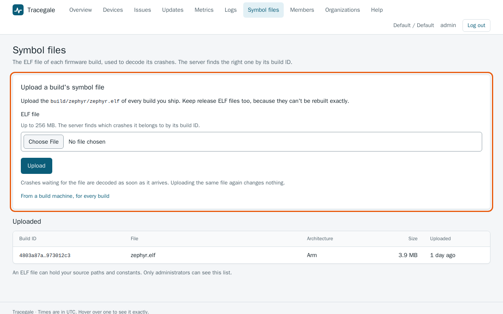
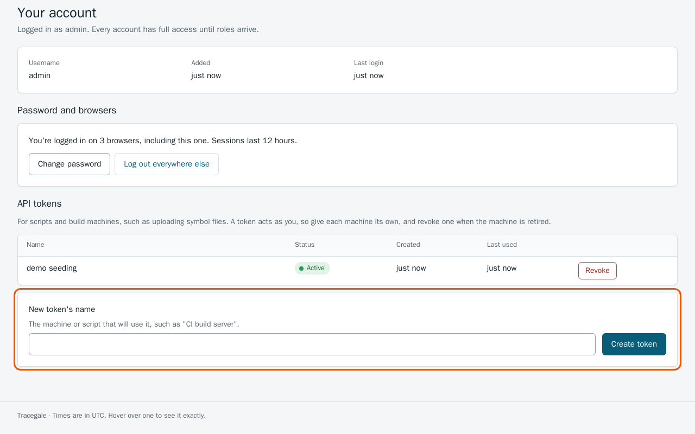
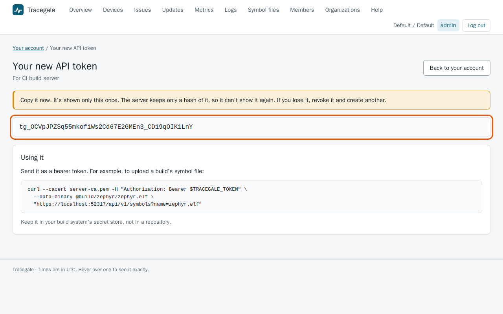

# Upload symbol files

<!-- order: 5 -->
<!-- summary: Let Tracegale decode crashes by giving it each build's ELF file. -->

A crash from a device holds addresses and memory. To turn them into function names and source lines, Tracegale needs the ELF file of
the exact build that crashed. It finds the right one by the build ID inside it.

Upload `build/zephyr/zephyr.elf` for every build you ship. With sysbuild, it's `build/<your application>/zephyr/zephyr.elf`.

## Upload in the web view

1. Open **Symbol files**.
2. Under **Upload a build's symbol file**, choose the ELF file, then choose **Upload**.



3. The file appears in the list. Crashes that were waiting for it are decoded straight away.

Uploading the same file again does nothing, so it's safe to upload every build. A file that can't be used, such as one from a
build without a build ID, is refused with the reason.

## Or upload from your build machine

To upload every build automatically, your build or CI can do it with an API token.

4. Choose your username at the top right, to open your account. Under **API tokens**, give the new token a name, such as the
   machine that will use it, and choose **Create token**.



5. Copy the token. It's shown only this once.



> Keep the token in your build system's secret store, not in a repository. It acts as you. Revoke it from your account page when the
> machine is retired.

6. After each build, upload its ELF file. On the **Symbol files** page, **From a build machine** shows this command with your
   server's address filled in, and how to get `server-ca.pem` once:

```
curl --cacert server-ca.pem -H "Authorization: Bearer $TRACEGALE_TOKEN" \
  --data-binary @build/zephyr/zephyr.elf \
  "https://tracegale.example.com/api/v1/symbols?name=zephyr.elf"
```

If your server sits behind a proxy with a public certificate, such as Pangolin, leave out `--cacert server-ca.pem`.

Next: [Read crashes and issues](06-crashes.md).
