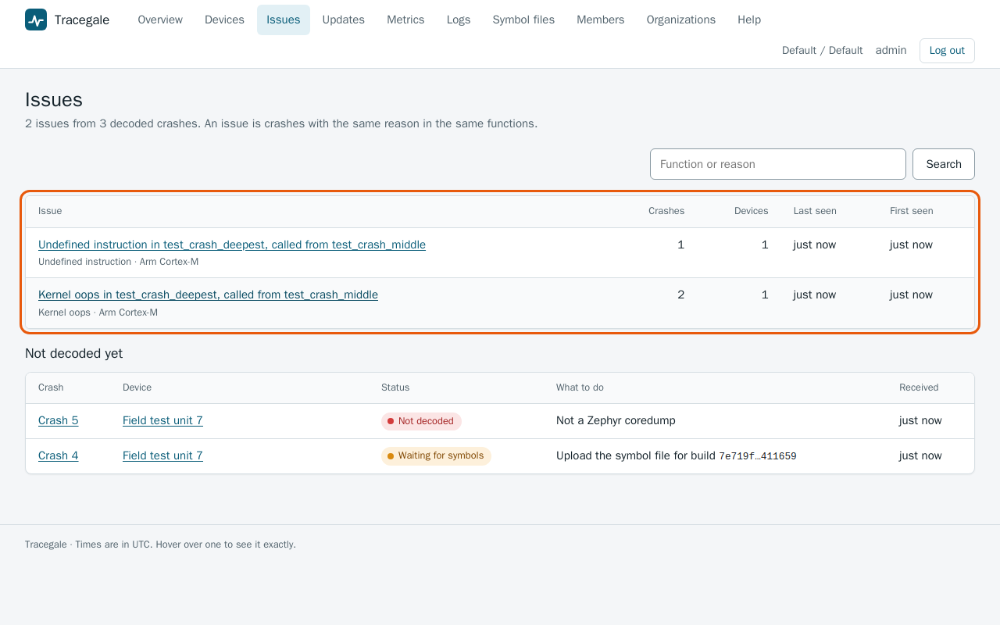
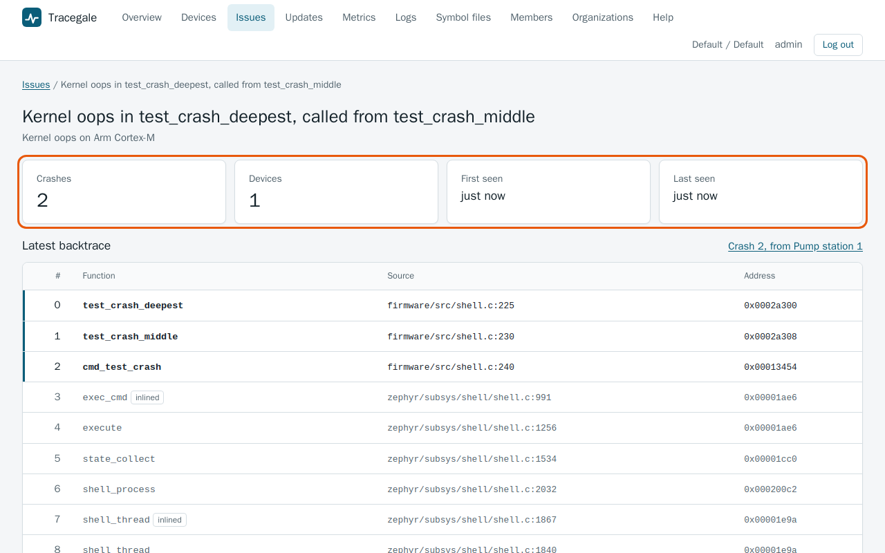
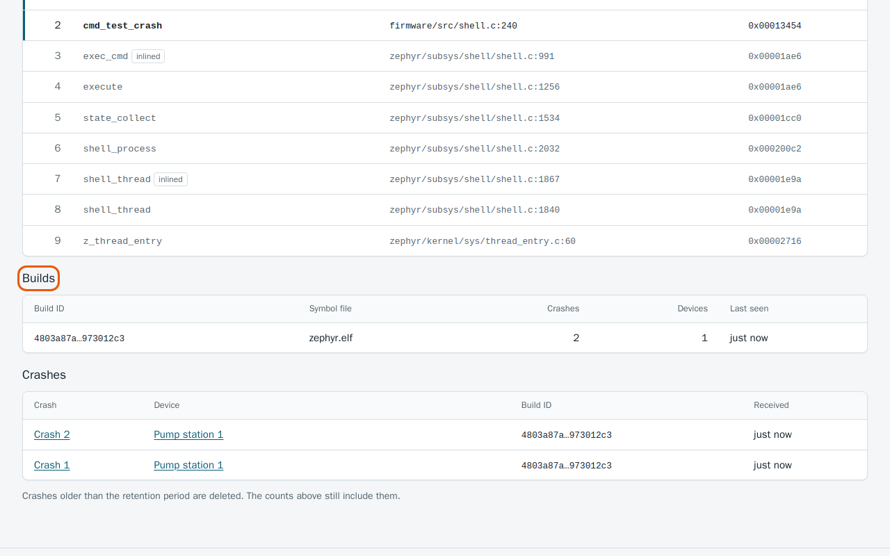
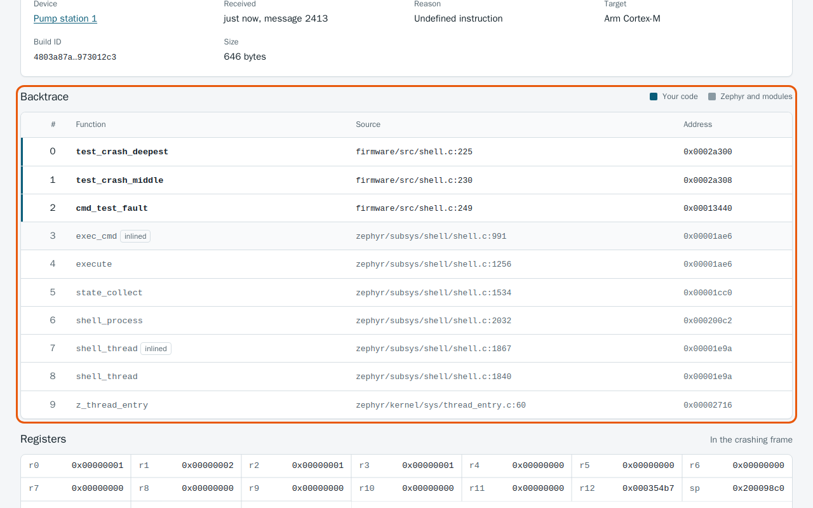
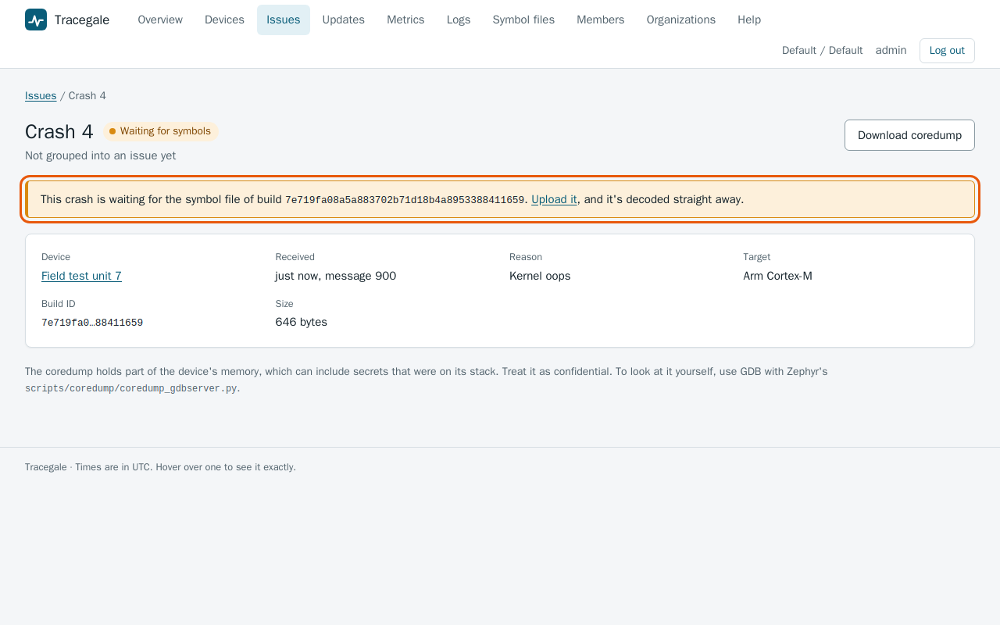

# Read crashes and issues

<!-- order: 6 -->
<!-- summary: Find what's crashing, on how many devices, and where in your code. -->

## Issues

An issue is a group of crashes with the same cause: the same reason, in the same functions. Line numbers don't count, so a rebuild
that moves code still groups with earlier crashes. **Issues** lists them, most recently seen first.

Below the list, **Not decoded yet** shows crashes that can't be decoded, and what to do about each.

## An issue

Open an issue to see how much it matters, and where it happens.

**Builds** shows which firmware builds the issue happens in. If it stops appearing in your newest build, your fix probably worked.

## A crash's backtrace

The backtrace lists the functions that were running when the device crashed, the newest first. **Your own code is in bold**, with a
blue edge. Zephyr's and other modules' frames are dimmed, because the cause is usually in your code. Hover over a file to see its
full path.

## Crashes that wait

A crash that arrives before its build's ELF file waits for it, and says so. Upload the file, and it's decoded straight away.

| Status | Meaning |
|---|---|
| **Decoded** | It has a backtrace, and belongs to an issue |
| **Decoding** | It's being decoded, or retried after a problem |
| **Waiting for symbols** | No ELF file with its build ID has been uploaded |
| **Not decoded** | It can't be, for the reason shown |

> A crash holds part of the device's memory, which can include secrets that were on its stack. Only people with an account can see
> it or download it.

Next: [Update your devices](07-updates.md).
