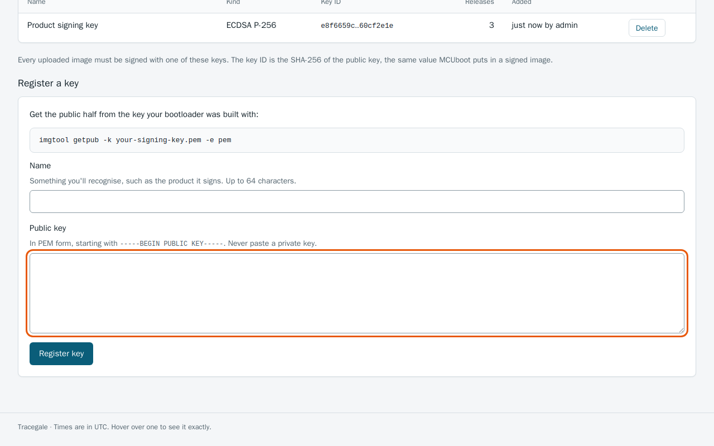
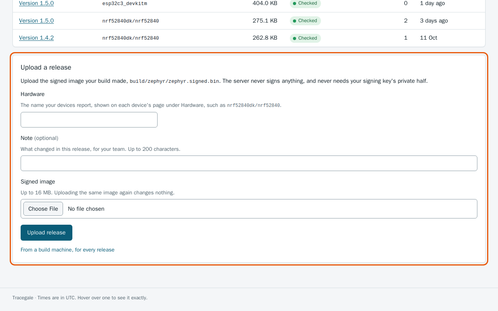
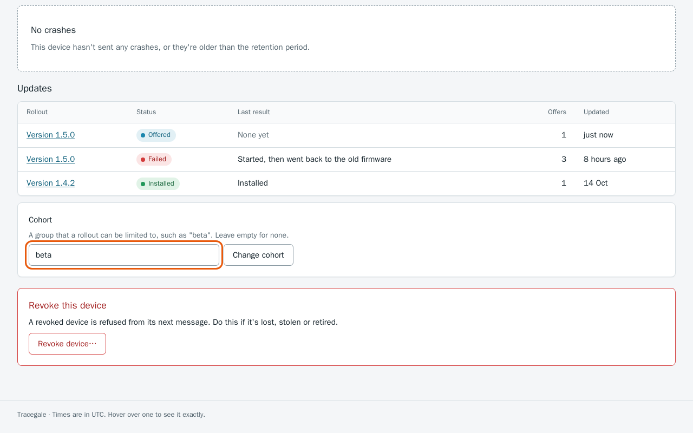
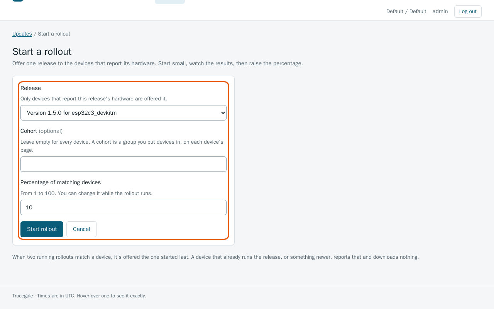
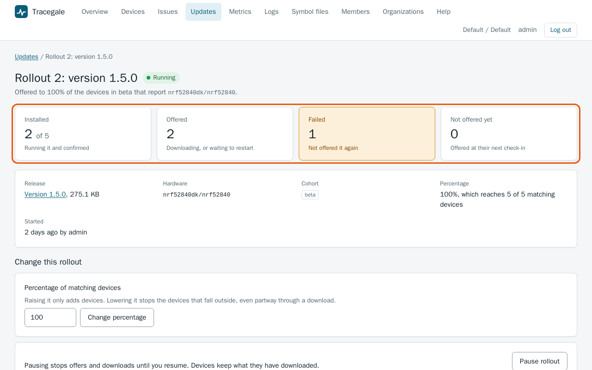
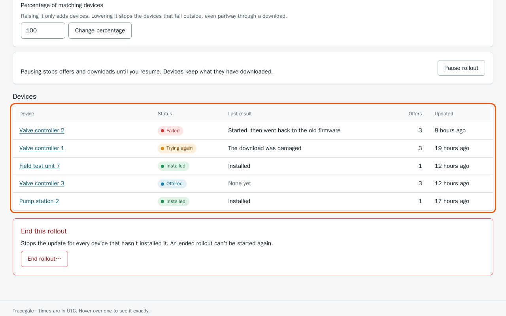
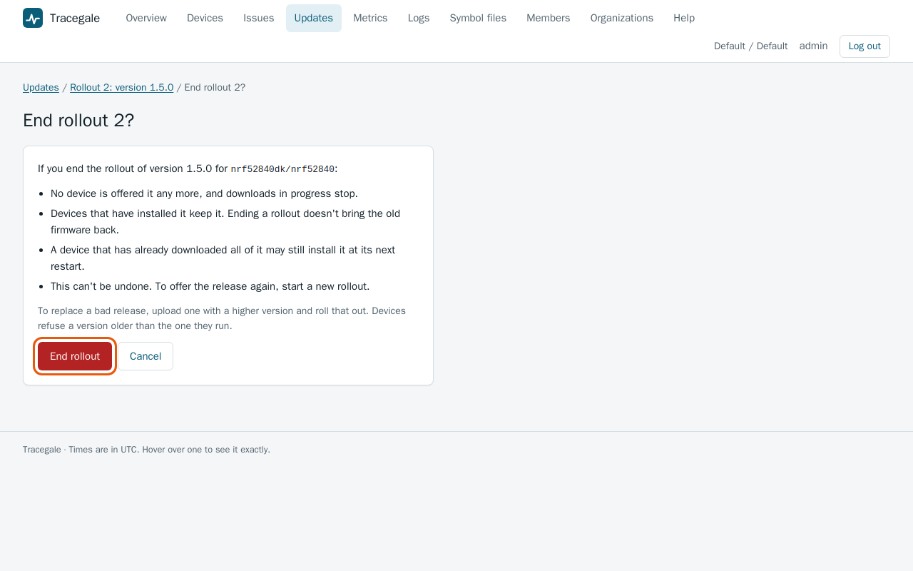

# Update your devices

<!-- order: 7 -->
<!-- summary: Send signed firmware to devices a few at a time, and stop when something goes wrong. -->

Tracegale delivers new firmware to devices over the connection they already have. Three things keep it safe:

- **Your build signs the image, and only the device's bootloader decides whether it runs.** The server never has your signing
  key, so even a breached server can't make a device run firmware you didn't sign.
- **A bad image goes back.** New firmware runs on trial. If it can't reach the server, the bootloader brings the old
  firmware back.
- **You choose who gets it, and how fast.** Start with a few devices, watch, then widen.

## Before the first update

Your firmware needs MCUboot with two image slots, which [Connect your firmware](03-firmware.md) covers. It also needs
**your own signing key**. Make one once, on a machine you trust:

```
imgtool keygen -k signing-key.pem -t ecdsa-p256
```

Name it in your application's `sysbuild.conf`, then build and flash your devices with it:

```
SB_CONFIG_BOOT_SIGNATURE_KEY_FILE="/path/to/signing-key.pem"
```

> Keep `signing-key.pem` away from the server, and back it up. Whoever has it can sign firmware for your devices. The
> bootloader in a shipped device holds its public half for good, so a lost key means those devices can't be updated.

## Register your signing key

Give the server the key's **public** half, so that it refuses any image you didn't sign.

1. Print the public half:

```
imgtool getpub -k signing-key.pem -e pem
```

2. Open **Updates**, then **Signing keys**.
3. Enter a name, paste the lines from `-----BEGIN PUBLIC KEY-----` to `-----END PUBLIC KEY-----`, and choose **Register key**.



> Images signed with MCUboot's development keys are always refused. Those keys are published, so anyone can sign with them.
> A build that names no key uses one, and warns about it.

## Upload a release

A release is one signed image, for one kind of hardware.

4. Open **Updates**. Under **Upload a release**, enter the **Hardware** your devices report, an optional note, and choose the
   signed image, `build/zephyr/zephyr.signed.bin`. With sysbuild, it's at `build/<your application>/zephyr/zephyr.signed.bin`.
5. Choose **Upload release**. The release's page opens.



- **Hardware is the name your devices report**, shown as **Hardware** on each device's page. It must match exactly. Only
  devices that report it are ever offered the image.
- **Raise the version for every release**, in your application's `VERSION` file. Devices refuse a version older than the
  one they run.
- An image that isn't signed, is signed with a development key, or isn't signed by a registered key is refused, with the
  reason.
- Upload the ELF file of the same build too, under **Symbol files**, so that its crashes can be decoded.

To upload releases from your build machine instead, use an API token as [Upload symbol files](05-symbol-files.md) shows. On the
**Updates** page, **From a build machine** has the command with your server's address filled in.

## Put test devices in a cohort

A cohort is a named group of devices, such as `beta`. A rollout can be limited to one.

6. Open a device you test with, enter a name under **Cohort**, and choose **Change cohort**.



## Start a rollout

A rollout offers one release to the devices you choose.

7. On **Updates**, choose **Start a rollout**.
8. Choose the release. To send it to your test devices first, enter their cohort. Leave **Cohort** empty for every device.
9. Enter the percentage of those devices to offer it to, and choose **Start rollout**.



Each device is offered the update at its next check-in. It downloads the image, restarts into it, and reports the result.
A download that's interrupted, by a lost connection or a power cut, continues where it stopped.

A sensible order: the test cohort at 100%, then every device at 10%, then raise the percentage as the results come in.

## Watch it

The rollout's page counts the devices in each state.



Below, each device has its own row, with the result it last reported.



| Status | Meaning |
|---|---|
| **Offered** | The device has been told about the update, and is downloading it or waiting to restart |
| **Trying again** | A try failed, and the device is offered the image again |
| **Installed** | The device runs the new firmware, and has reached the server with it |
| **Failed** | It failed three times, or in a way that trying again can't fix. The device isn't offered this rollout's image again |

| Last result | What happened | What to do |
|---|---|---|
| The bootloader didn't start it | MCUboot refused the image | Check that it's signed with the key the device's bootloader was built with |
| Started, then went back to the old firmware | The new firmware started, but didn't reach the server in its trial time, or it restarted | Test the new firmware on a device on your bench. A crash it sent is under **Issues** |
| The download was damaged | The image in the device's flash didn't match | Nothing. It's downloaded again |
| Too large for the device | The image doesn't fit the device's second slot | Make the image smaller, or check the hardware name |
| Not an MCUboot image | The image doesn't start as one should | Upload `zephyr.signed.bin` |
| Refused as older than what it runs | The device runs a newer version | Raise the version and upload again |
| The device's storage failed | Writing flash or settings failed | Check the device's flash |

A device's own page lists every update it was offered, under **Updates**.

## Pause, change or end a rollout

On the rollout's page:

- **Pause rollout** stops offers and downloads at once. Devices keep what they've downloaded, and continue when you resume.
- **Change percentage** widens the rollout. Raising it only adds devices. Lowering it stops the devices that fall outside.
- **End rollout** stops it for good. It asks you to confirm first.



## When a release turns out bad

1. **End its rollout.** No more devices get it.
2. Devices that already installed it keep it. Ending a rollout doesn't bring the old firmware back, and devices refuse older
   versions.
3. Fix the fault, **raise the version**, upload the new release, and roll it out.

> A device that has already downloaded the whole image may still install it at its next restart, even after the rollout has
> ended.

Next: [Watch your fleet's metrics](08-metrics.md).
