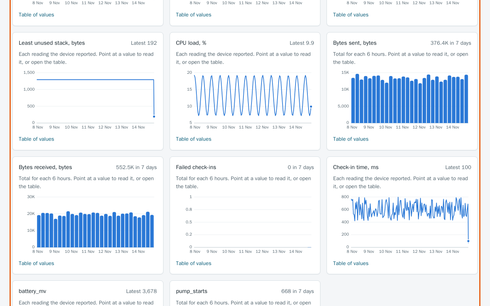
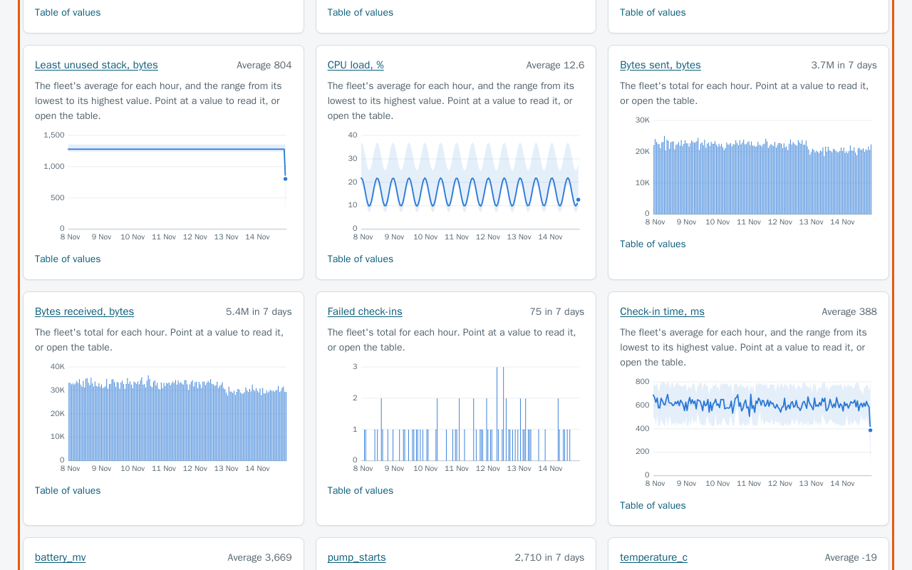
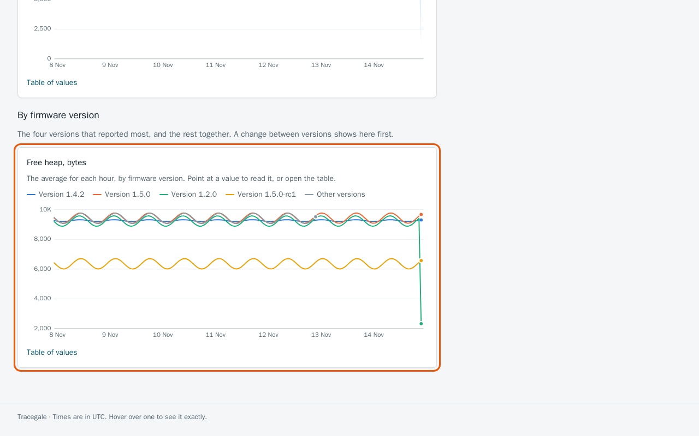

# Watch your fleet's metrics

<!-- order: 8 -->
<!-- summary: See memory, CPU, network use and your own values, for one device or the whole fleet. -->

Each time a device checks in, it also reports what it measured since the last time. You can see it for one device, and for
the whole fleet, one firmware version against another.

## What devices report

With `CONFIG_TRACEGALE=y`, devices report these by themselves:

| Metric | What it tells you |
|---|---|
| Free heap, and lowest free heap | Whether memory runs short, or leaks over days |
| Least unused stack | Whether a thread came close to overflowing its stack |
| CPU load | How busy the device was. Needs `CONFIG_THREAD_RUNTIME_STATS=y` in your application |
| Bytes sent and received | How much data the device uses. Needs `CONFIG_NET_STATISTICS_USER_API=y` |
| Failed check-ins, and check-in time | How well the device reaches the server |
| Uptime | When it last restarted |

Your firmware can add its own, such as a battery's voltage or how often a door opened:

```c
TRACEGALE_METRIC_GAUGE_DEFINE(battery_mv);
TRACEGALE_METRIC_COUNTER_DEFINE(door_opened);

TRACEGALE_METRIC_SET(battery_mv, 3712);
TRACEGALE_METRIC_ADD(door_opened, 1);
```

A **gauge** is a reading, and a chart shows each one. A **counter** adds up, and a chart shows its total for each hour or
day. Names are letters, digits and `_`, up to 32 of them. The firmware's guide, `docs/firmware/README.md`, has the details.

## One device

Open a device, then **See this device's metrics**. Choose a period at the top. Point at a value to read it, or open
**Table of values** under a chart.



A line that stops means the device reported nothing for a while: it was off, or couldn't reach the server. Values it
couldn't send then arrive later, in its next report.

## The whole fleet

**Metrics** in the menu shows every metric across all devices. For a reading, the line is the fleet's average, and the
shaded band runs from the lowest value any device reported to the highest. For a counter, each column is the fleet's total.



Open a metric's name to compare firmware versions. The four versions that reported most get a line each, and the rest share
one. A release that uses more memory or CPU than the one before shows here first, which makes this the page to watch during
a rollout.



## How long they're kept

Each device's reports are kept for 30 days, and the fleet's hourly figures for 400. Your administrator can change both, and
how many different metric names the fleet may have, which is 1,000 unless changed. A device's values for names beyond that
limit are dropped, and the server's log says so.

> Counters are estimates, not accounts. If a device's report arrives but the server's reply is lost, the device sends the
> same values again, and the server counts them twice.

Next: [Read your devices' logs](09-logs.md).
