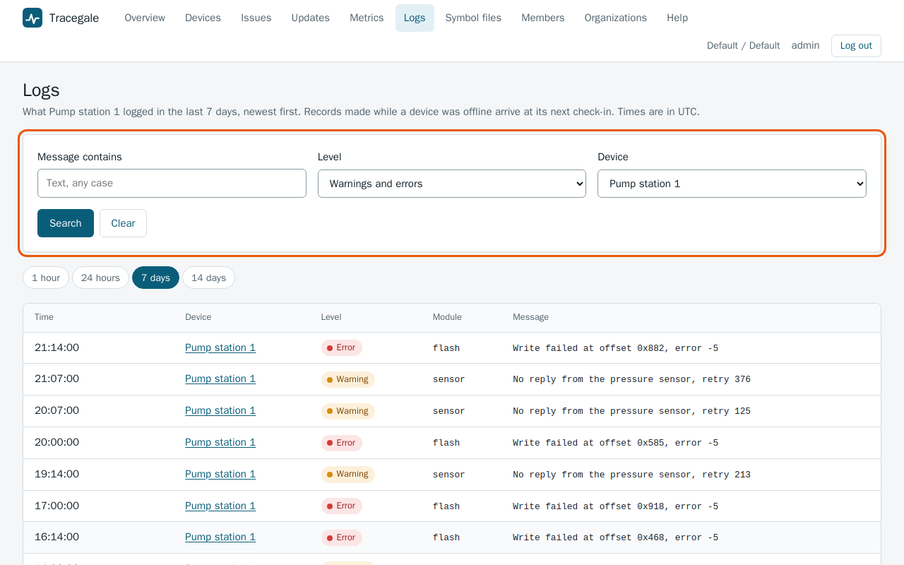
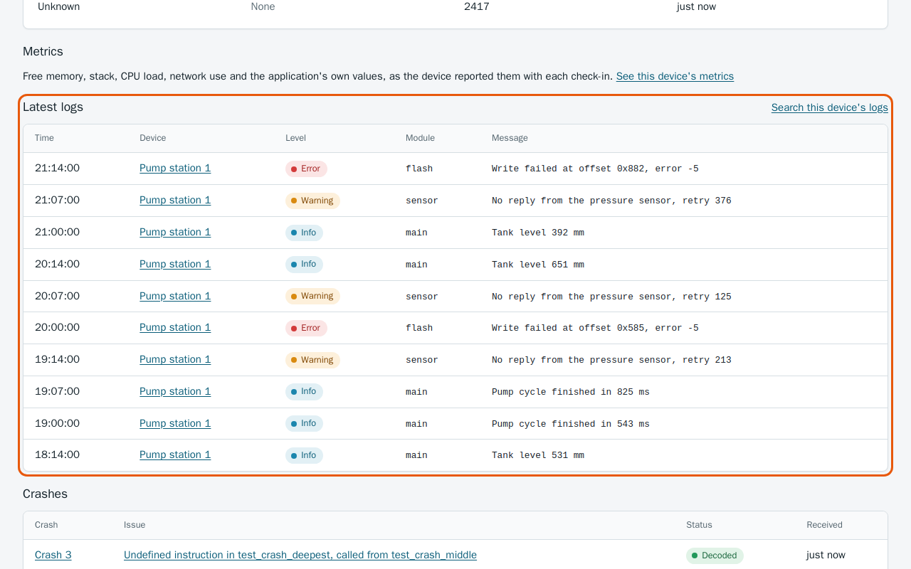

# Read your devices' logs

<!-- order: 9 -->
<!-- summary: Search what your devices logged, including what they logged while they couldn't reach the server. -->

Your firmware already logs with Zephyr's `LOG_INF()`, `LOG_WRN()` and `LOG_ERR()`. Tracegale keeps those records on the
device and sends them with each check-in, so you can read them here without a cable, including records made while the device
was offline.

## Turn it on

Logs are sent when your application has Zephyr's logging on:

```
CONFIG_LOG=y
```

That's all. Records at info level and above are kept, in 2 KB of RAM. When that fills before the next check-in, the oldest
records go, and the server shows a warning saying how many were lost. The firmware's guide, `docs/firmware/README.md`, has
the options.

> Logs travel over the same encrypted connection as everything else, but anyone with an account can read them. Don't log
> passwords, keys or personal data.

## Search

**Logs** in the menu shows the newest records first. Search for any part of a message, choose a level and a device, and
pick a period above the list.



- **Time** is when the device logged the record, worked out from how long it had been running. **(arrived)** marks a record
  whose time the device couldn't give, so the time shown is when it reached the server.
- **Module** is the part of the firmware that logged it, the name in its `LOG_MODULE_REGISTER()`.
- **Older records** at the end goes back a page at a time.

## One device

A device's page shows its ten latest records. **Search this device's logs** opens the search for that device.



## How long they're kept

Records are kept for 14 days, and each device may store 10,000 a day; your administrator can change both. A device that
logs more than that has the rest dropped, and the server's log says so. Log less, or raise the level, in that device's
firmware.

Next: [Manage members and projects](10-accounts.md).
