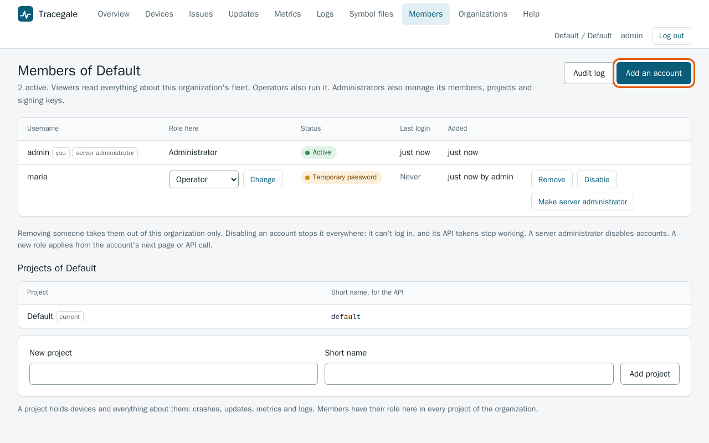
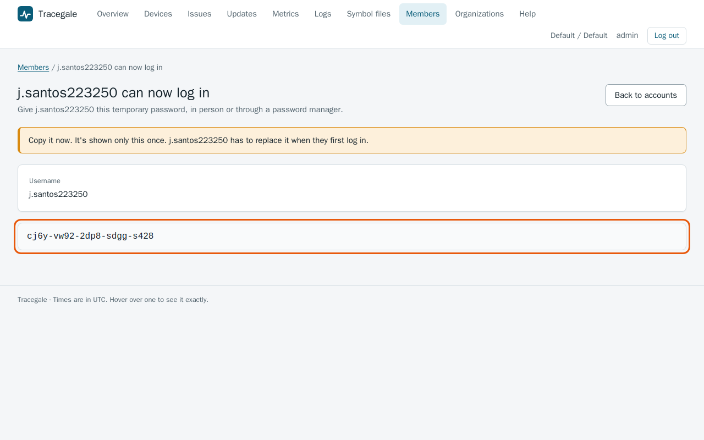
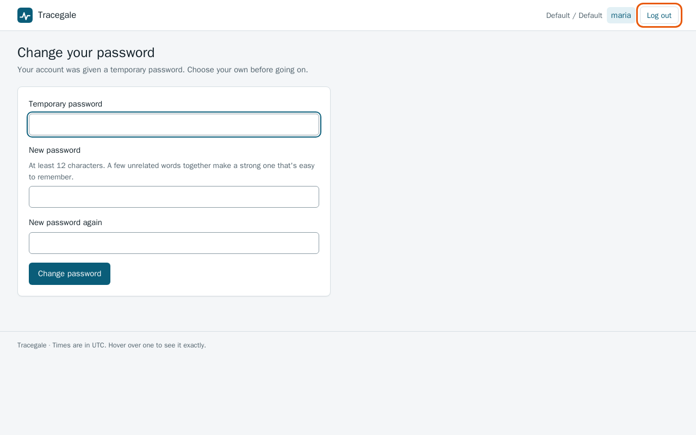
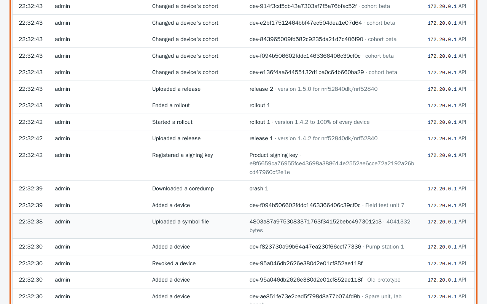
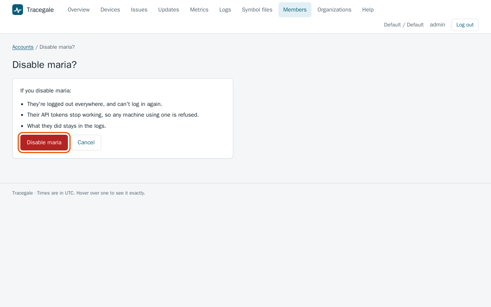

# Manage members and projects

<!-- order: 10 -->
<!-- summary: Add the people who can log in, choose what each can do in each organization, organize devices into projects, and see who did what. -->

Everyone who uses Tracegale should have their own account, so nobody shares a password, and the audit log shows who did what.

## Organizations and projects

- A **project** holds devices and everything about them: crashes and issues, symbol files, releases and rollouts, metrics and
  logs. Use one for each product, or each team's fleet. What's in one project can't be seen from another.
- An **organization** holds projects, and its **members** have a role in it, over all its projects.
- One account can be a member of several organizations. The name of the current organization and project is at the top of
  every page; with more than one, choose another there and **Switch**.

## Roles

Each member has one role in the organization:

| Role | Can |
|---|---|
| Viewer | Read everything about the fleet: devices, crashes, updates, metrics and logs. Changes nothing, and can't download coredumps, which can hold secrets from a device's memory |
| Operator | Also add and revoke devices, set cohorts, upload symbol files and releases, run rollouts, and download coredumps |
| Administrator | Also manage the organization's members and projects and its signing keys, and read its audit log |
| Server administrator | Not a role in an organization, but the install's: adds organizations, disables accounts, and can work in every project as an administrator |

Give each person the least they need. Everyone manages their own password and API tokens, and an API token can do what its
account's role allows, so a build machine's token belongs to an operator's account.

## Add someone

1. Open **Members**, then choose **Add an account**. The account becomes a member of the current organization.



2. Enter their username, choose their role, and choose **Create account**. Tracegale makes a temporary password.
3. Give them the temporary password, in person or through a password manager. It's shown only this once.



4. When they first log in, they choose their own password before they can do anything else.



## Single sign-on

If your administrator has set up single sign-on, the login page has a **Log in with** button. The first time you use it,
Tracegale makes your account, and your groups at your organisation's sign-on service decide your role, each time you sign
in. Your password is managed there, not here.

## Change someone's role

On **Members**, choose the new role next to their name, and **Change**. It applies from their next page or API call. You
can't change your own role. **Remove** takes someone out of this organization only.

## Add a project

On **Members**, under **Projects**, give the project a name and a short name, such as `pumps`, which scripts use to name it
and which never changes. Then switch to it at the top of the page, and add its devices from **Devices**.

A server administrator adds organizations from **Organizations**, each with its first project.

## See who did what

**Audit log**, at the top of **Members**, lists every change anyone made, newest first: logins, failed logins, accounts and
roles, devices, symbol files, coredump downloads, signing keys, releases and rollouts. Each has the account, the time, what it
was done to, and the address it came from. Filter by account or action. Events are kept for 400 days.



## Remove someone

Choose **Disable** next to their account, and confirm. They're logged out everywhere, and their API tokens stop working. Their
history stays.



## Forgotten passwords

Another administrator can disable the account and add it again. Or, on the server:

```
docker compose exec server /tracegale reset-password <username>
```

That gives the account a new temporary password and logs it out everywhere.

## Your own password

Choose your username at the top right, then **Change password**. Your other browsers are logged out. If you suspect someone else
used your account, choose **Log out everywhere else** too.

Next: [Reach Tracegale from outside](11-remote-access.md).
