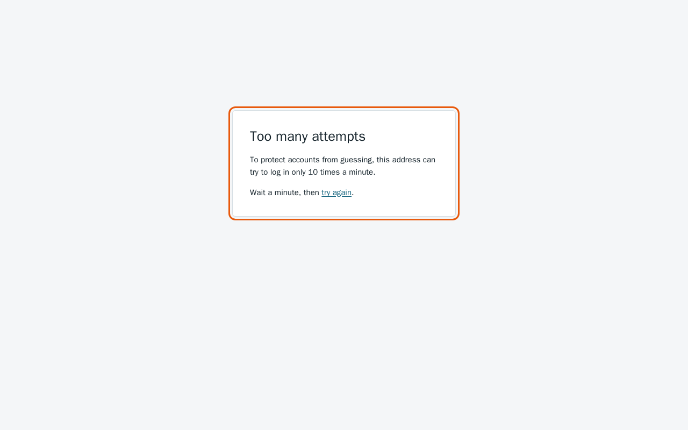

# When something goes wrong

<!-- order: 12 -->
<!-- summary: What common problems mean, and what to do. -->

## Logging in

| What you see | What to do |
|---|---|
| "That username and password don't match" | Check both. After 10 wrong tries, the account waits 15 minutes |
| **Too many attempts** | Your address tried to log in more than 10 times a minute. Wait a minute |
| You're sent to **Change your password** | Your account has a temporary password. Choose your own to go on |
| You forgot your password | See "Forgotten passwords" in [Manage members and projects](10-accounts.md) |



## A device doesn't come online

On the device, run `tracegale status` and look at `last error`:

| Error | Meaning | What to check |
|---|---|---|
| 1 | Not provisioned | Paste all the commands from **Add a device**, ending with `tracegale commit` |
| 2 | The server's name didn't resolve | The name, and the application's DNS |
| 3 | No connection | The network, the port, and any firewall |
| 4 | TLS failed | The name in `tracegale server` must be one the server's certificate has, and the credentials must come from this server |
| 9 | The server refused a message | The number after `detail` is the server's reason. 11 means the device was revoked |
| 11 | Storage failed, on `tracegale commit` or `erase` | On an nRF91 series device, the modem's link must be off. See "In the nRF Connect SDK" in [Add Tracegale to your firmware](03-firmware.md). Otherwise, the application's settings storage |
| 13 | Over MQTT, the broker refused the device | Detail 5: the device's certificate isn't from this server. Use the port for MQTT, 8883, not 8443 |
| 14 | Over MQTT, the certificate names no device | The device's certificate must be the one this server issued for it |

The full list is in the repository: `docs/firmware/errors.md`.

## A crash isn't decoded

Open it from **Not decoded yet** on the **Issues** page. It says why: usually its build's ELF file hasn't been uploaded. See
[Upload symbol files](05-symbol-files.md).

## A device doesn't update

Open the rollout from **Updates**, and look for the device under **Devices**.

| What you see | What to check |
|---|---|
| "No device matches this rollout" | The release's hardware name must be exactly what **Hardware** says on the device's page |
| The device isn't listed | It hasn't checked in since the rollout started, it isn't in the rollout's cohort, or it falls outside the percentage. Raise the percentage to reach more devices |
| The rollout is **Paused** or **Ended** | Resume it, or start a new rollout of the release |
| **Offered** for a long time | The device is downloading, or waiting for the application to let it restart. On the device, `tracegale status` shows `update:` with the bytes so far |
| **Trying again** or **Failed** | The **Last result** column says why. The table in [Update your devices](07-updates.md) says what to do |
| The device runs firmware without updates | Its build warned that updates are off, and said why. It needs MCUboot with two image slots, and settings storage |

An upload that's refused says why. The most common reasons:

| The server says | What to do |
|---|---|
| The image is signed with a development key | Build with your own signing key. See [Update your devices](07-updates.md) |
| The image isn't signed with a registered signing key | Sign it with the key you registered, or register this key's public half under **Updates**, **Signing keys** |
| It isn't an MCUboot image | Upload `zephyr.signed.bin`, not `zephyr.bin` or the ELF file |

## Something else

The server's log says what happened, with the device and message ID for anything a device sent:

```
docker compose logs server
```
